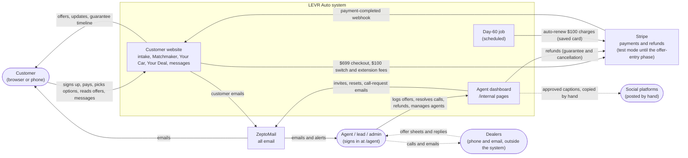
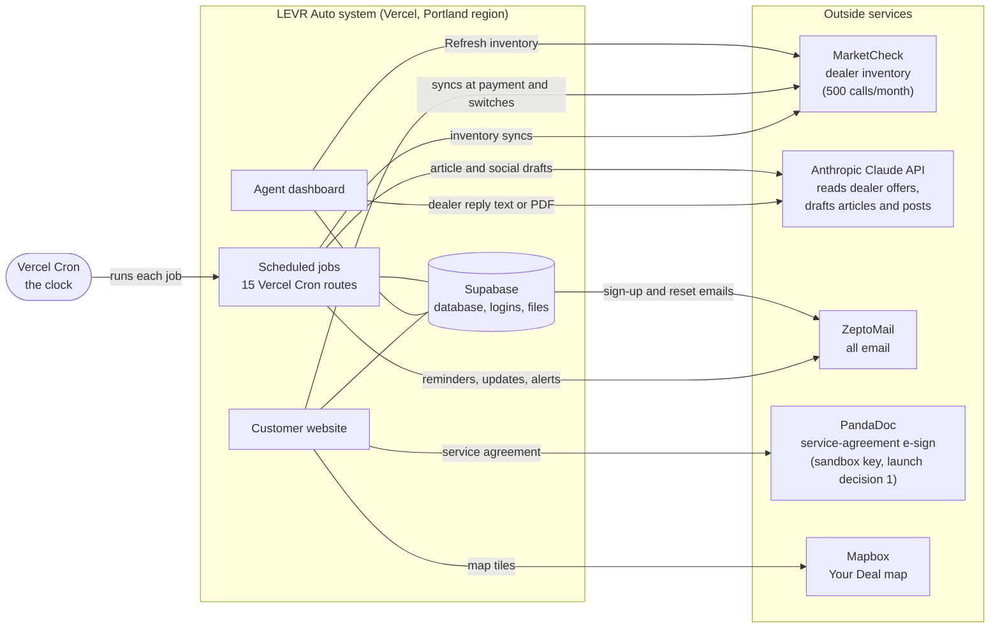

# Context diagram: LEVR Auto and everything around it

**Pilot, 2026-10-15.** Drawn from the Phase 1 branch (`agent-dashboard-phase1-code` at `1d95e28`). The live site runs `main` until the Phase 1 deploy, so the agent sign-in, assignment and alert pieces shown here aren't live yet.

**How to read it:** the box in the middle is the system we build and run. Everything outside it is a person, a company's service, or a scheduled trigger. Each arrow says what passes between them. It's drawn as two diagrams (Brett, 2026-10-15): **people and money**, then **services and jobs**.

## 1. People and money

| From → to | Code behind it |
|---|---|
| Customer → Stripe checkout | `createCheckoutSession` (`src/lib/payment-actions.ts`), `createSwitchFeeCheckoutSession`, `createExtensionCheckoutSession` |
| Stripe → webhook | `src/app/api/stripe/webhook/route.ts` (`search_payment`, `switch_fee`, `extension_fee`) |
| Day-60 job → auto-renew | `attemptAutoRenewCharge` (`src/lib/day60-extension.ts`) |
| Agent → refunds | `issueGuaranteeRefund`, `recordExistingGuaranteeRefund` (`guarantee-refund-actions.ts`), `resolveCancellation` |
| Emails | `sendEmail` (`src/lib/email.ts`); `.invalid` recipients never sent |

## 2. Services and jobs

| From → to | Code behind it |
|---|---|
| Jobs | `vercel.json`; each job's route under `src/app/api/cron/` (table below) |
| MarketCheck | `syncListingsForMakeModel` (`marketcheck-sync.ts`), `marketcheck-scheduler.ts`, `refreshSearchInventory` |
| Anthropic | `parseDealerOffer` (`offer-parsing-actions.ts`), `article-generation.ts`, `social-generation.ts` |
| PandaDoc | `src/lib/pandadoc/client.ts`, `service-agreement-actions.ts` |
| Auth emails ("sign-up and reset emails") | Supabase Auth, custom SMTP set to ZeptoMail (dashboard setting) |

## What each outside party sees

| Party | What the system sends it | What it never gets |
|---|---|---|
| Stripe | the $699 fee, $100 switch and extension fees, refunds | nothing about the vehicle beyond the line-item text |
| MarketCheck | make, model, page number | any customer details |
| ZeptoMail | each email's address, subject and body | `.invalid` test addresses (stopped in `sendEmail`) |
| Anthropic | a dealer's reply (text or PDF); article and post prompts | customer account details |
| PandaDoc | the customer's name and email, for the agreement | anything else |
| Dealers | only what an agent tells them, by phone or email | nothing automatic; no customer details before an offer is accepted |

## Scheduled jobs (Vercel Cron, times in UTC)

| When | Job |
|---|---|
| every hour at :00 | solidify searches 24 hours after finalizing |
| every hour at :15 | **agent sweep** (Phase 1): assign any paid search with no agent, then send alert emails |
| every hour at :30 | unpaid-search reminders (switched off until a mailing address is set) |
| 06:00 daily | nightly inventory sync for searched models |
| 07:00 Sundays | weekly/monthly inventory refresh |
| 08:00 daily | Day-30 guarantee check; Day-60 deadline reminder |
| 09:00 daily | Day-60 pause (tries auto-renew first) |
| 10:00 daily | resume reminder for paused searches |
| 11:00 daily | delete offer sheets of ended searches |
| 12:00 daily | post-deal survey |
| 13:00 daily | daily update email |
| 14:00 daily | draft next month's article |
| 15:00 daily | article review reminders to agents |
| 22:00 Sundays | weekly social post batch |

Source: `vercel.json` on the branch.
