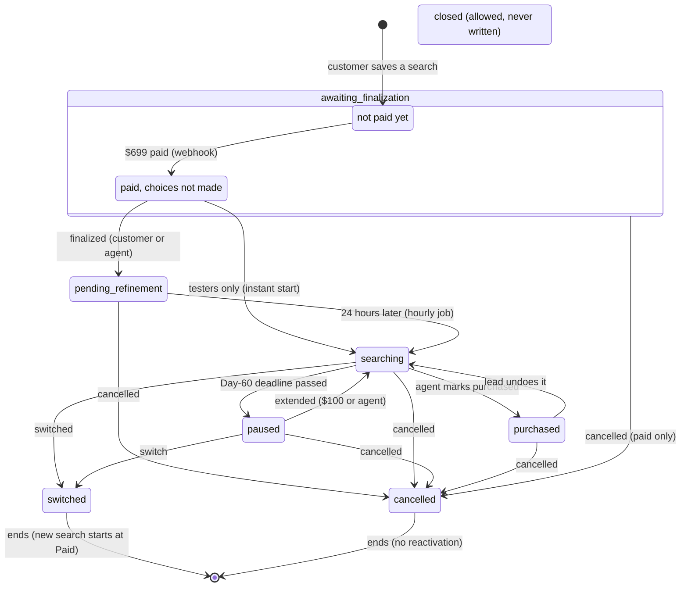

# State machine: a customer search

**Pilot, 2026-10-15.** From the database check constraint (`search_status`, 8 allowed values) and every place in the branch code and migrations that changes it.

**How to read it:** the diagram uses short labels; the table underneath gives the full rule and the code for each arrow. Each box is a value of `customer_searches.search_status`. Each arrow is something that moves a search on, with who or what does it. A search that ends (switched, cancelled) never comes back; a switch creates a **new** search.

## The transitions, with the code that does each

| From → to | Who or what | Where |
|---|---|---|
| (new) → awaiting_finalization, unpaid | customer, at intake or pop-up sign-up | `saveIntakeSearch`, `src/lib/unpaid-search.ts` (one unpaid search per customer) |
| unpaid → paid (status unchanged) | Stripe webhook, `search_payment` | `src/app/api/stripe/webhook/route.ts` (sets `paid_at` once; replays do nothing) |
| awaiting_finalization → pending_refinement | customer; or agent on a finalization or consultation call | `finalizeSelfService`; `finalizeSearchByAgent`, `finalizeUndecidedSearch` |
| awaiting_finalization → searching | tester accounts only (instant start, `TESTER_INSTANT_START_ENABLED`) | `src/lib/tester-sample-offers.ts` |
| pending_refinement → searching | hourly job at :00 | `src/lib/search-solidification.ts` |
| searching → paused | Day-60 job, 09:00 | `pauseOverdueSearches`, `src/lib/day60-extension.ts` |
| paused → searching | extension paid (webhook `extension_fee`) or agent bypass | webhook route; `grant_extension_bypass` |
| searching → purchased | agent | `markSearchPurchased` (needs `deal_progress` availability and deposit) |
| purchased → searching | lead (C16 role gate) | `revert_purchased_search` |
| several → cancelled | customer (no refund) or agent (with refunds) | `cancel_search` (allow-list: awaiting_finalization, pending_refinement, searching, paused, purchased) |
| searching or paused → switched | customer (free in the first 5 days, else $100) or agent | `switch_customer_search`; the new search keeps the agent (Step 5) |

## Things that are NOT search states (and so aren't drawn)

- **The guarantee** has its own field, `guarantee_status` (pending → met or refunded), set by the Day-30 job.
- **Assignment** (which agent has the search) is separate: any paid search not switched, cancelled or closed should have an agent. See the payment-to-assignment sequence.
- **Call requests** (finalization, switch, cancellation) are timestamps on the search, not states. They get their own state machine in the full set.
- **Admin pause/resume:** the database functions `admin_pause_search` / `admin_resume_search` still exist, but their buttons were removed on 2026-09-27, so nothing calls them.
- **The free make/model correction** (`updateSearchVehicle`, before solidifying) changes the vehicle, not the status.
