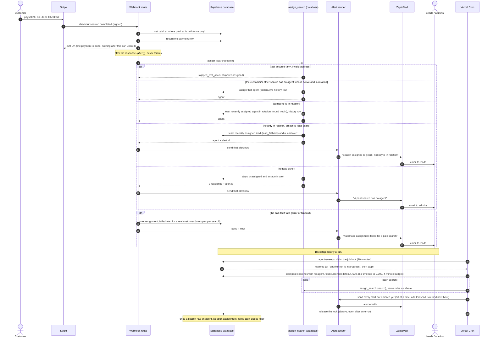

# Sequence: payment → webhook → assignment → alert email

**Pilot, 2026-10-15.** The Phase 1 path from a customer paying the $699 to a search having an agent (or a lead or admin being told why it doesn't). From `src/app/api/stripe/webhook/route.ts`, `src/lib/search-assignment.ts`, `src/lib/agent-alerts.ts`, the `assign_search` database function (Steps 4, 13, 15) and `src/app/api/cron/agent-sweeps/route.ts`. Not live until the Phase 1 deploy.

**How to read it:** time runs downwards. Solid arrows are calls; dashed arrows are answers. `alt` boxes are the branches; only one runs.

## Rules this diagram depends on

- **Payment is never held up or undone by assignment.** The webhook answers Stripe first; assignment runs after the response and never throws. (Tested: c3-B forced failure, webhook still 200, payment recorded.)
- **Exactly once.** A Stripe replay finds `paid_at` already set and does nothing, so assignment isn't called again. (c3-A replay.)
- **Admins are never picked by the system.** The fallback takes leads only (`role = 'lead'`). An admin who opts into rotation is picked by round-robin like anyone else.
- **Away never changes assignment;** deactivated agents are never assigned.
- **Switches:** the new search keeps the agent inside the database (`inherited_switch`); the extra call then answers `already_assigned`. (c3-switch.)
- **Scope:** outside production the sweep only runs on named searches (`?only=`); in production a manual `?only=` run is logged `[job-scoped]` and answers `scoped: true`.
